# TDengineGUI

> TDengineGUI is a useful and simple desktop manager for [TDengine](https://github.com/taosdata/TDengine), compatible with Linux, windows, mac. It helps developer to observe and manipulate data easier when they use TDengine as their Alot big data platform.

[中文版](https://github.com/skye0207/TDengineGUI/blob/main/README_.md)
## Features
- Link to TDengine, create and drop databases
- show tables and surpertables, select data.
- execute the SQL statements using a simple console.
- Connect to Apache IoTDB 2.x in Table or Tree model.

## Downloads

### Windows：

Download latest [exe](https://github.com/skye0207/TDengineGUI/releases/tag/v1.0.0) package from [release](https://github.com/skye0207/TDengineGUI/releases/tag/v1.0.0)[or [gitee](https://gitee.com/skyebaobao/TDengineGUI/releases/v1.0.0) in China].

### Mac：
Download latest [dmg](https://github.com/skye0207/TDengineGUI/releases/tag/v1.0.0) package from [release](https://github.com/skye0207/TDengineGUI/releases/tag/v1.0.0).

### Linux：
Download latest [AppImage](https://github.com/skye0207/TDengineGUI/releases/tag/v1.0.0) package from [release](https://github.com/skye0207/TDengineGUI/releases/tag/v1.0.0) [or [gitee](https://gitee.com/skyebaobao/TDengineGUI/releases/v1.0.0) in China].


## Dev Build Setup：
```bash
# clone code 
git clone https://github.com/skye0207/TDengineGUI.git

cd TDengineGUI

# install dependencies
npm install

# serve
npm run start
```

## Apache IoTDB 2.x

Choose **Apache IoTDB** in the new connection dialog. Configure the host, REST port (default `18080`), username, password, REST protocol, and Table or Tree model. The REST service must be enabled and reachable; use HTTPS when configured. Tree databases use a full `root...` path, such as `root.factory`, while Table databases use a plain database name.

The navigation panel can list, create, and delete databases. After selecting a database, the browser lists tables in Table mode or devices in Tree mode; selecting an object shows its schema and timestamp-ordered data pages, with a time filter. Use the SQL console to query or execute SQL in the selected database. The data browser fetches a maximum of 20 rows at a time; console queries are limited to 1000 rows and 8 MiB, and larger results may need narrower SQL filters.

IoTDB connection details and passwords are kept for the current app session only; profiles do not store IoTDB passwords on disk. Re-enter the password the next time the app is launched.

Run offline REST and pagination tests with `npm run test:iotdb`. The opt-in `npm run test:iotdb:live` test creates and drops temporary databases in both models. Configure `IOTDB_REST_URL`, `IOTDB_USER`, and `IOTDB_PASSWORD` first, and point it only at a test IoTDB 2.x instance.

## Build Package
```bash
# Packaged application will generate in the dist folder
npm run build 
```

## Welcome to use TDeningeGUI

- TDengineGUI reconds previous connections.

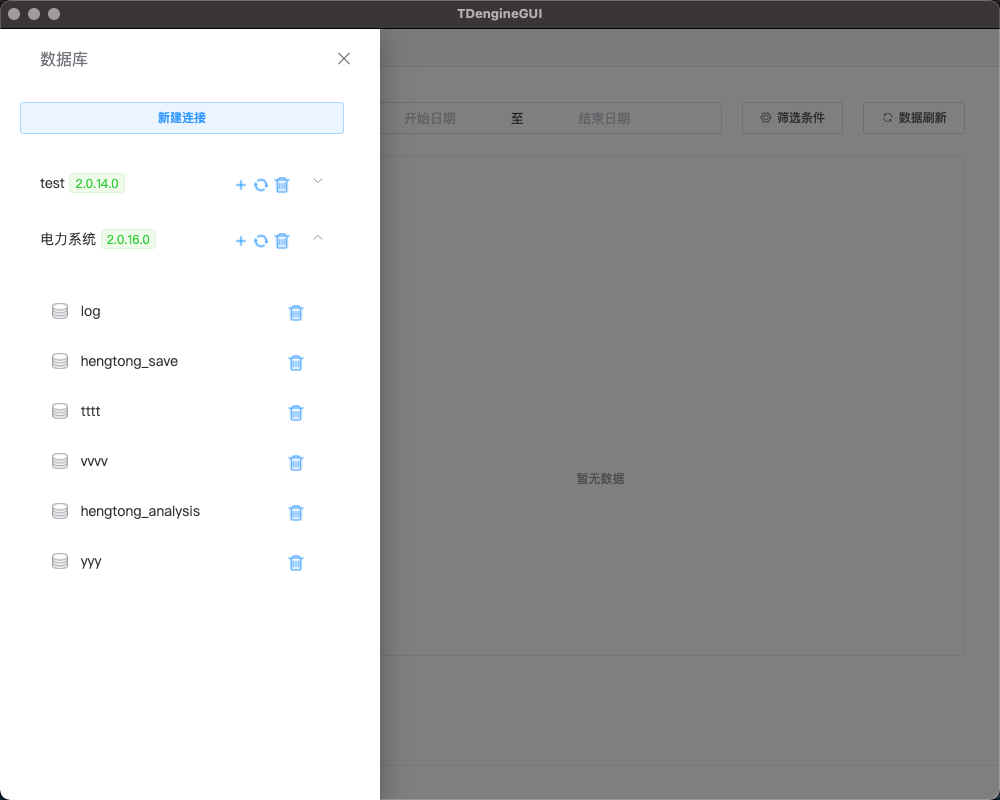

- You also could add a new server to manage by clicking the "新建连接" button and providing ip,port,username and password(root:taosdata).

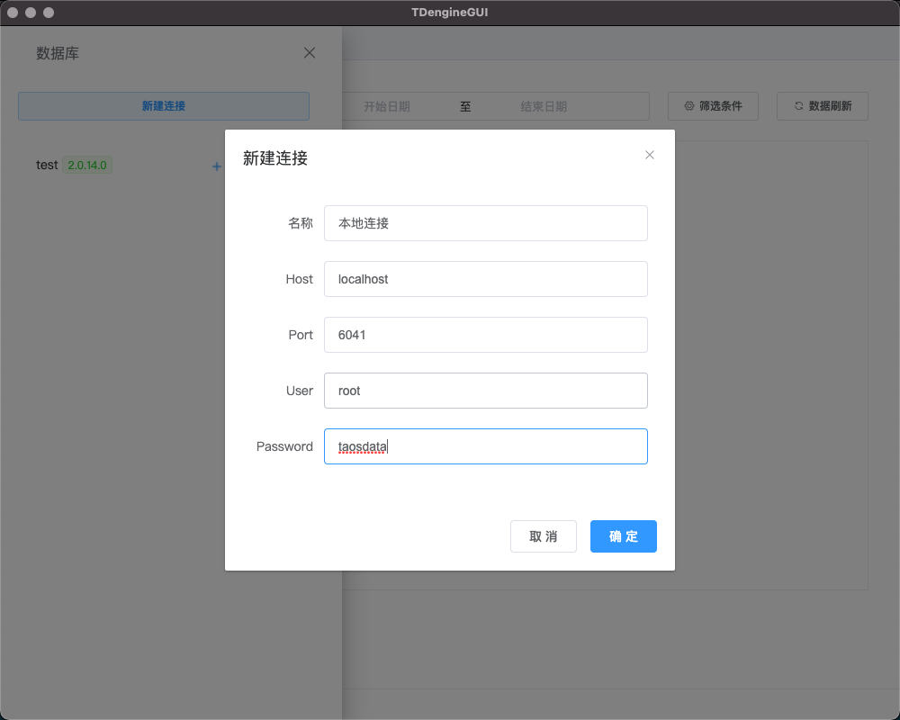

- Drop a database.

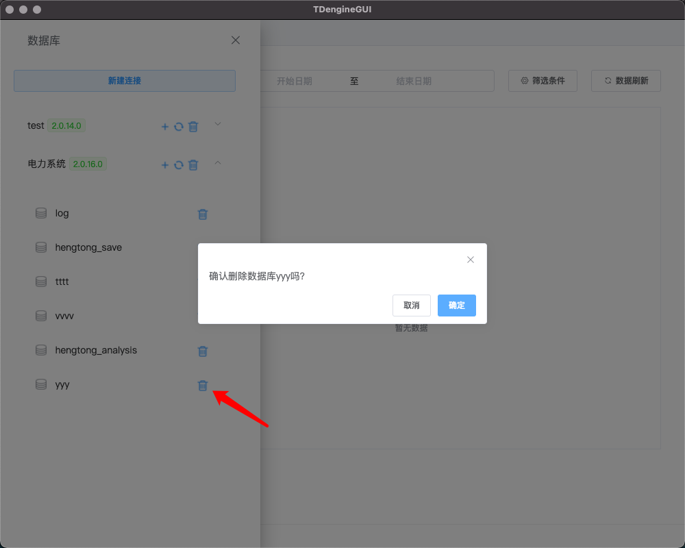

- Create databases. Specific attributes refering [tdengine document](https://www.taosdata.com/cn/documentation/taos-sql#management)

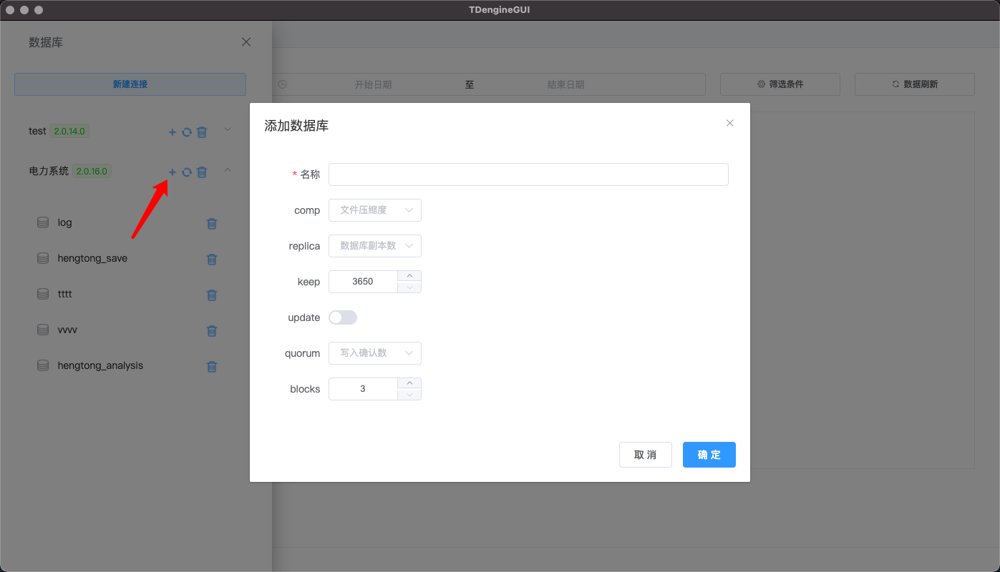

- Delete a linked server.

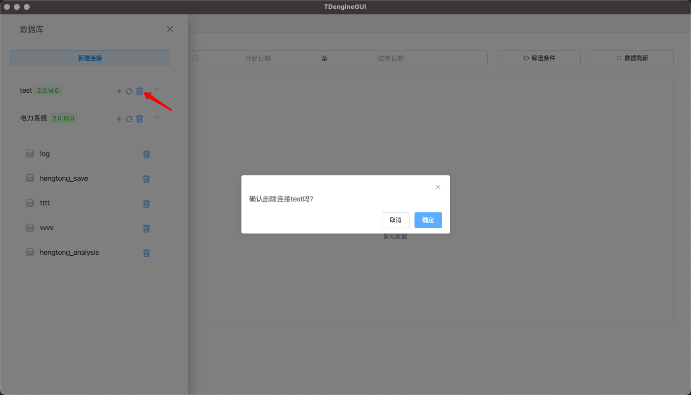

- Select a database and enter main panel. You could click "切换" button to switch database.

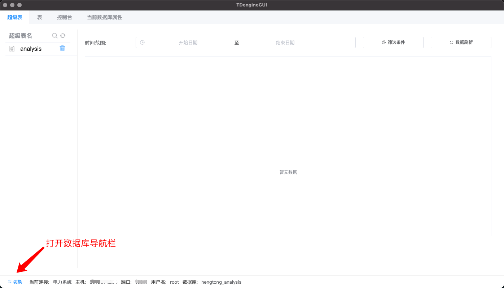

- Click a table to query data.

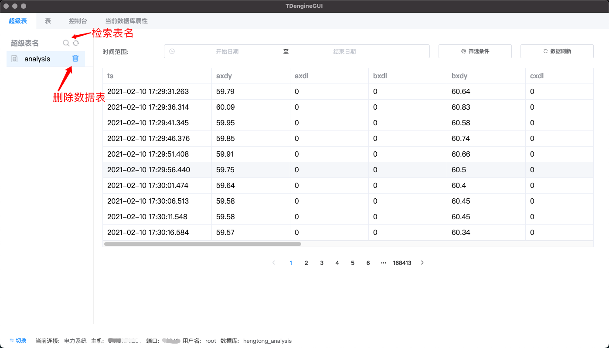

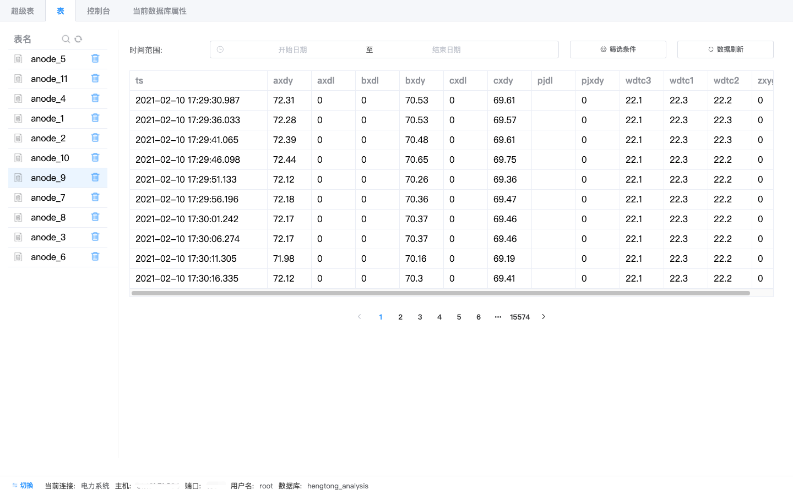

- Query data by filtering the timestamp.

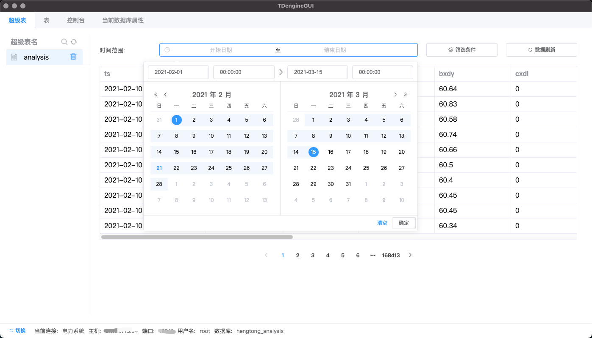

- Set data filter.

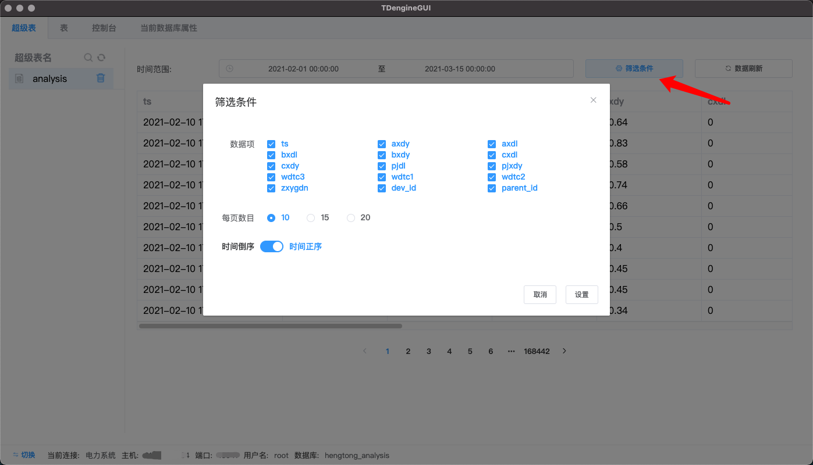

- A simple console to execute the SQL statements. SQL will execute on the current database by default, so you don't need to add the database name. But you can also operate on the other database by using "databaseName.tableName".

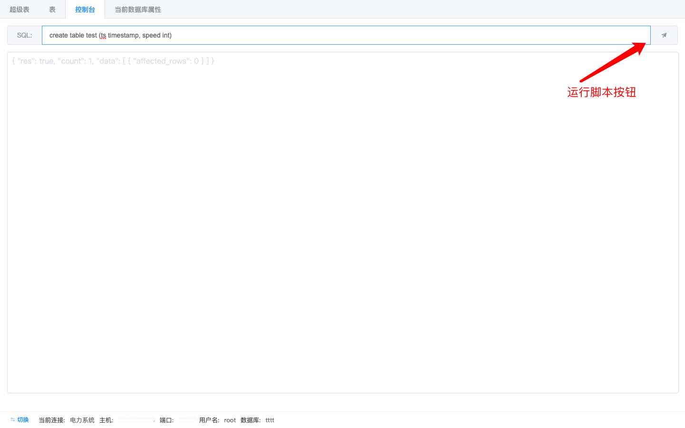

- Simplely display database properties. More features will be developed in the future.

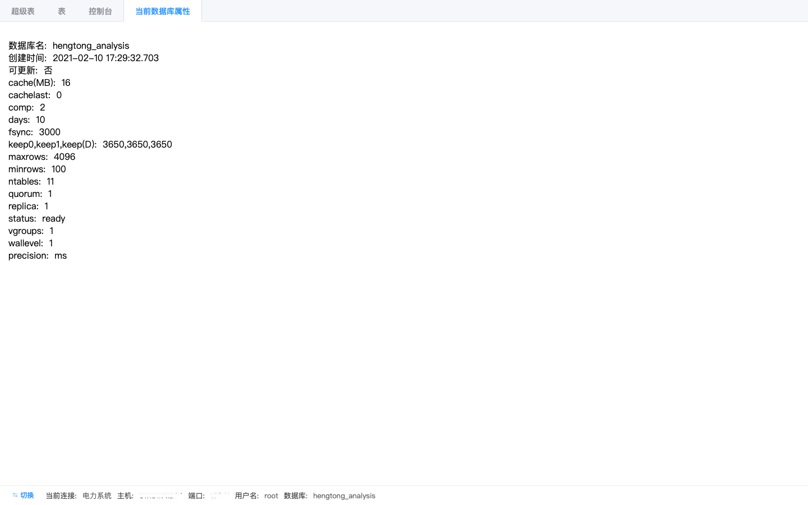
